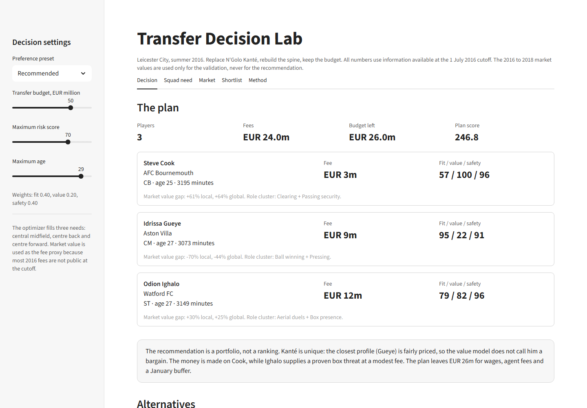
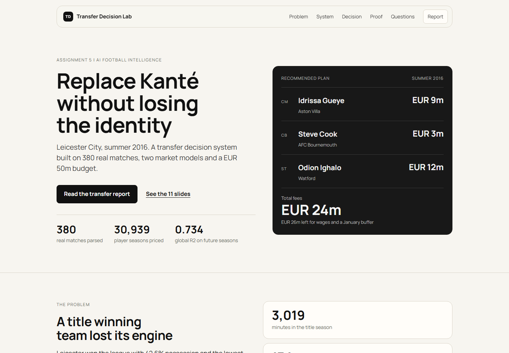

# Transfer Decision Lab

**AI Football Intelligence: from data to transfer decisions**

Assignment 5, AAI-2504M, October 2026

Team: Dinmukhammed Mynzhassar, Laura Duisenova, Zhaidar Kairat

Leicester City, summer 2016. Replace N'Golo Kanté, rebuild the spine and stay inside a EUR 50m fee budget.

## The decision

| Need | Player | Club | Fee | Fit | Value | Safety |
|---|---|---|---:|---:|---:|---:|
| Central midfield | Idrissa Gueye | Aston Villa | EUR 9m | 95 | 22 | 91 |
| Centre back | Steve Cook | AFC Bournemouth | EUR 3m | 57 | 100 | 96 |
| Centre forward | Odion Ighalo | Watford | EUR 12m | 79 | 82 | 96 |

Total fees: **EUR 24m**. Left for wages, agent fees and a January buffer: **EUR 26m**.

Gueye is the closest real-match profile to Kanté. Cook is the strongest value signal in the pool. Ighalo is the best available box threat. The value model does not call Gueye a bargain; the case for him is tactical fit and availability. The money is made on Cook.



[Open the live project page](https://va11eyard.github.io/ai-sport/)

Source: `site/index.html`



## Key evidence

- 380 Premier League matches and 10,385 player-match rows from StatsBomb open data.
- 30,939 top five league player seasons from a Transfermarkt datalake.
- Global market value model: R2 0.734, Spearman 0.855 on 2021/22 to 2024/25.
- Local event model: R2 0.614 against 0.495 for a baseline that knows age, minutes, role and club rank.
- Undervalued players gained 11.8% in market value over two years, while the rest lost 10.9%.
- Hit rate 52.8% against 35.8%. The global model beat the rest in all 10 evaluation seasons on a relative basis.
- Recommended plan backtest: +52% market value from 2016 to 2018. Two hits and one miss.

## Why this case

Kanté was a 100th percentile ball winner and only a 54th percentile passer among Premier League midfielders. Leicester did not need a playmaker. They needed a destroyer who could carry the ball. The project measures that asymmetry from real match actions, prices the market, and then solves a three-player plan under a fee budget. The case is retrospective so the recommendation can be checked against 2016 to 2018 market values. Those values are never used to make the recommendation.

## What is inside

| Path | Content |
|---|---|
| `app.py` | Streamlit decision support app |
| `src/transfer_lab/` | Event parsing, features, value models, scouting, optimisation, figures |
| `scripts/download_data.py` | Public raw data download |
| `scripts/build_all.py` | End-to-end pipeline |
| `scripts/verify.py` | Evidence table and test run |
| `data/processed/` | Compact processed tables used by the app |
| `outputs/tables/` | Candidate, model, scenario and decision tables |
| `outputs/figures/` | Report and slide figures |
| `report/` | DOCX and PDF report |
| `presentation/` | 11-slide PDF deck and speaker script |
| `presentation/SPEAKER_SCRIPT.md` | Per-speaker script and Q&A bank |
| `presentation/SHORT_SCRIPTS.md` | Short slide lines and 60 second app demo |
| `presentation/APP_EXPLAINER.md` | Plain language walkthrough of the app |
| `demo/` | Screenshots and demo script |
| `site/` | Static project page built with the landing page design system |
| `assets/` | Manrope font, license and shared design tokens |
| `upload/` | Submission copies of the report and slides |

## Run it

App only:

```bash
pip install -r requirements.txt
python -m streamlit run app.py
```

Full pipeline and report:

```bash
pip install -r requirements-dev.txt
python scripts/download_data.py
python scripts/build_all.py
python scripts/verify.py
python -m streamlit run app.py
```

The app runs offline from `data/processed` and `outputs`. Raw data is not committed because the StatsBomb event files alone are about 1.1 GB. The download script recreates them from public URLs.

The report can be rebuilt with:

```bash
python report/build_report.py
python presentation/build_slides.py
```

PDF output uses Playwright Chromium. Install the browser once with `python -m playwright install chromium` if needed.

## Validation

The project uses four checks:

1. Temporal holdout for the global market model. Train up to 2020/21, test 2021/22 to 2024/25.
2. Five-fold out-of-fold predictions for the local event model.
3. A two-year market value backtest for the undervalued signal, locally and across 10 seasons.
4. A brute-force check of the MILP optimum over the top eight candidates per need.

Nine unit tests cover counts, model improvement over the baseline, leakage controls, the budget constraint and the decision summary. Run `python scripts/verify.py` to print the evidence table and execute the tests.

## Limitations

- Market value is a fee proxy, not a transfer fee.
- The Transfermarkt minutes column is unreliable for some high scorers. The local model uses StatsBomb minutes; the global model uses appearances and starts.
- Some 2015/16 profiles are missing from the datalake. The matching keeps only verified players.
- The candidate pool is one league and one season.
- Position labels are formation slots, not roles. The similarity score corrects the label.
- The market underprices defensive actions. A negative value gap is not a football verdict.
- The 2016 to 2018 outcomes are hindsight. They validate the method, not the decision process.
- Correlation is not causation.

## AI use

An LLM coding assistant was used for code scaffolding, event-schema checks, debugging and drafting. It was given the data schemas, the case constraints and the cutoff rule. It did not generate the reported numbers. All tables and figures come from the committed scripts. The team checked the player mapping, the model specification and the recommendation.

## Links

- Repository branch: `dev` of [github.com/Va11eyard/ai-sport](https://github.com/Va11eyard/ai-sport)
- Live page: https://va11eyard.github.io/ai-sport/
- Project page source: `site/index.html`
- Speaker script: `presentation/SPEAKER_SCRIPT.md`
- Short scripts: `presentation/SHORT_SCRIPTS.md`
- App explainer: `presentation/APP_EXPLAINER.md`
- Report: `report/Assignment5_Report.pdf`
- Slides: `presentation/Assignment5_Presentation.pdf`

## Data

- StatsBomb open data: [github.com/statsbomb/open-data](https://github.com/statsbomb/open-data)
- Transfermarkt datalake: [github.com/salimt/football-datasets](https://github.com/salimt/football-datasets)

Data belongs to its sources and is used here for academic research. Check the source terms before redistribution.
